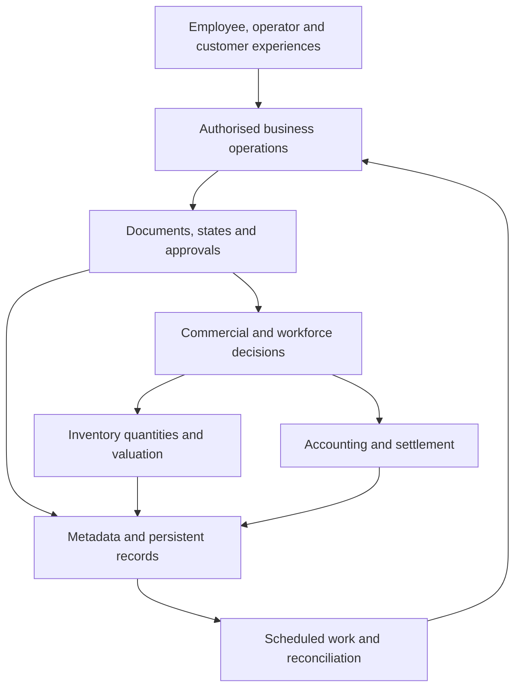

# Enterprise Application Behavioural Blueprint

This repository specifies a unified enterprise application through its observable decisions, records, calculations, permissions, transactions, and business consequences. It is intended for an independent implementation without assuming an implementation language, framework, database product, hosting topology, or prior knowledge of the reference system.

The September reference edition follows four supplied source snapshots, including their shared application foundation. The [November rebuild specification](docs/rebuild/README.md) follows separately pinned ERPNext and Frappe v16 releases and named extension revisions. The [checkpoint reading guide](checkpoints/reading-guide.md) assembles the complete September edition and the current supplements into a single searchable directory. Current accounting, distribution, manufacturing, customer relationships, workforce, payroll, projects, support, and shared administration form one specification. Historical upgrade procedures, deprecated compatibility shims, product deployment recipes, and a prospective implementation platform are outside this boundary. An actively selectable behaviour remains in scope even if it has existed for many years.

## Review the blueprint

Start with the [coverage register for all 21 ERPNext modules](docs/rebuild/coverage-review/README.md). It connects each module to its business workflows, field dictionary and release changes. Open the [September reader](checkpoints/september/README.md) to browse the full narrative edition on GitHub, including [domain chapters](checkpoints/september/docs/domains/README.md) and [calculation contracts](checkpoints/september/schemas/mathematics/README.md). The [corrected operation lookup](docs/rebuild/checkpoint-corrections/README.md) resolves every one of the 33,360 September identifiers.

For a transaction-level review, start with [project costs from purchase through invoice](docs/rebuild/coverage-review/project-costing.md) or [warehouse picking, packing and dispatch](docs/rebuild/warehouse-fulfilment/README.md). For a deployment with optional applications, consult the [workflow profiles for 313 pinned marketplace sources](docs/rebuild/marketplace-workflows/README.md), the [69 multilingual extension guides](docs/rebuild/marketplace-guides/README.md) and the [qualification register](docs/rebuild/qualification.json).

## Architecture at a glance

A transaction can change operational progress, inventory value, financial balances, party settlements, and employee entitlements together. Recreating screens and record tables without these effects does not establish equivalent behaviour.

## Start here

| Purpose | Reading path |
|---|---|
| Build from the November research | [Release profile, reading order and qualifications](docs/rebuild/README.md) |
| Design a multilingual ERP with optional applications | [69 marketplace extension guides in four languages](docs/rebuild/marketplace-guides/README.md) · [Language selection and document rendering](docs/rebuild/marketplace-guides/languages/README.md) |
| Follow physical and financial records together | [Supplier receipt through repack, sale, return and cash](docs/rebuild/integrated/README.md) |
| Understand the full boundary | [Scope and source baseline](docs/overview/scope-and-baseline.md), then [business compatibility map](docs/overview/business-compatibility-map.md) |
| Understand the architecture | [Application architecture](docs/overview/application-architecture.md), then [cross-domain transactions](docs/domains/cross-domain-transactions.md) |
| Rebuild records and calculations | [Domain model](docs/data/domain-model.md), [physical data catalog](docs/data/physical-data-catalog.md), then the [mathematical catalog](schemas/mathematics/README.md) |
| Rebuild user and service behaviour | [Interfaces](docs/interfaces/README.md) and [runtime semantics](docs/runtime/README.md) |
| Plan and verify an implementation | [Reimplementation sequence](docs/reimplementation/sequence.md), [acceptance strategy](docs/reimplementation/acceptance-strategy.md) |
| Assess the evidence and remaining uncertainty | [Coverage and evidence](docs/references/coverage-and-evidence.md) and [source traceability](schemas/traceability/README.md) |
| Find every document | [Documentation index](docs/README.md) |
| Consume structured specifications | [Machine-readable catalogs](schemas/README.md) |

## Definition of compatibility

Compatibility means the same supported operation, input, configuration, prior records, identity, and effective time produce the same accept-or-reject decision, persisted facts, state transitions, amounts, quantity consequences, and externally visible completion or failure. Exact source-language identifiers and branded transport paths are replaced with neutral names. Existing clients expecting those literal names require an adapter; this repository specifies semantic compatibility rather than claiming a byte-for-byte reproduction of named routes.

Language forms part of the compatibility profile. Record the language of the operator, recipient and issued document separately. A translated control must invoke the same authorized business operation, and a reprint must identify the language and version issued to the recipient. The [multilingual contract](docs/rebuild/marketplace-guides/languages/README.md) gives the reference behaviour and worked examples.

Each rule distinguishes observed source behaviour, a derived example, and a proposed improvement. An apparent anomaly is retained as a compatibility finding until resolved. Industry convention never silently replaces a contradictory source decision.

## Evidence and completeness

The September structural baseline contains **1,044 record definitions and 16,813 declared fields**, including layout fields, child records, and settings records. Source inventory, field inventory, semantic review, numerical example checks, and execution against a running reference application are separate measures. Consult the coverage report before making an equivalence claim. Cataloging a function or a record does not establish that all of its decisions have been specified or executed.

The November research adds separately pinned field dictionaries, decision tables, an extension source directory and real site observations for [financial postings](docs/rebuild/live/README.md), [inventory and production](docs/rebuild/stock-live/README.md) and [permission and transaction boundaries](docs/rebuild/platform-live/README.md). The [portable comparison](docs/rebuild/comparison/README.md) lets another implementation compare its ledger effects with those observations.

The specification contains original explanatory prose and neutral structured facts. Source archives and source implementation code are not included. The unchanged repository license is [Apache License, Version 2.0](LICENSE).
