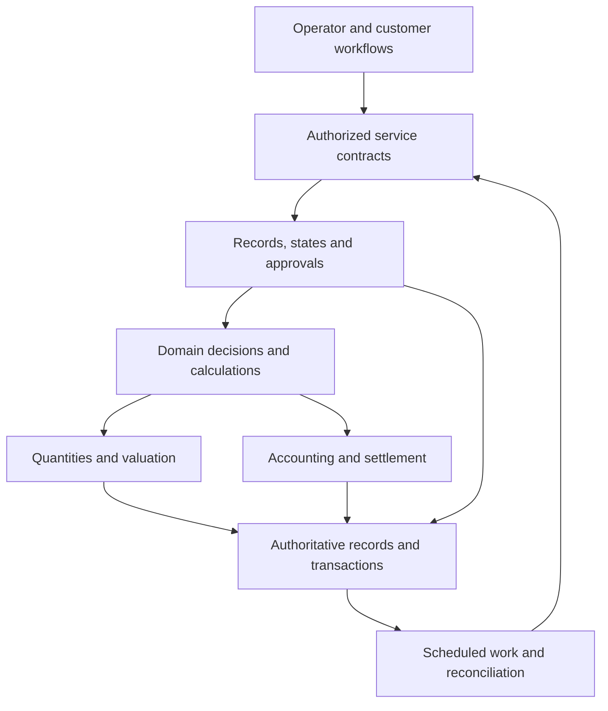

# Enterprise Application Behavioural Blueprint

**September reference edition.** Browse the [domain chapters](docs/domains/README.md), [machine-readable calculations](schemas/mathematics/README.md) or [guide to the full catalog](catalog-access.md). These pages follow the four development snapshots. Use the [corrected operation lookup](../../docs/rebuild/checkpoint-corrections/README.md) for the complete set of distinct decision bodies. The [November release edition](../../docs/rebuild/README.md) records its own pinned versions and observations.

This repository specifies a unified enterprise distribution application through its business decisions, persistent records, calculations, permissions, operational workflows and financial consequences. It is a language-neutral rebuilding specification: an implementer should obtain a rule, its data structures, its dependent decisions and its acceptance examples from this repository.

Accounting is the common boundary across purchasing, sales, inventory, manufacturing, assets, employee expenses and payroll. The specification also covers customer relationships, projects, time billing, service, quality, maintenance and shared administration. Closely related capabilities share business concepts while retaining consequential differences in workflow, ownership and calculation.

The repository contains explanatory documents and machine-readable contracts. It does not prescribe an implementation language, framework, database vendor or deployment product. The [Apache License, Version 2.0](LICENSE) is preserved unchanged.

## Compatibility objective

Given the same supported operation, input values, configuration, prior records, caller identity and effective time, the replacement must reach the same accept-or-reject decision, preserve the same authoritative facts, perform the same state transitions and create the same quantity and financial consequences. Completion, failure, reversal, retry and externally visible output are part of that contract.

Neutral business names replace implementation-specific vocabulary. Exact external transport literals, when required by a counterpart, belong to a defined compatibility profile. A proposed improvement is identified separately from observed behavior. A mathematically surprising branch is not silently replaced with a preferred industry convention.

## Architecture at a glance

The [architecture chapter](docs/overview/application-architecture.md) explains the ownership boundaries. [Cross-domain transactions](docs/domains/cross-domain-transactions.md) explain how a single business operation coordinates operational progress, valuation and accounting. [Document lifecycle and transactions](docs/runtime/document-lifecycle-and-transactions.md) define validation, posting, cancellation and failure boundaries.

## Repository map

| Entry | What it provides |
|---|---|
| [Documentation index](docs/README.md) | Navigation to every explanatory area and chapter |
| [Overview](docs/overview/README.md) | Scope, architecture and business compatibility |
| [Data](docs/data/README.md) | Identity, persistence, value semantics, domain relationships and data exchange |
| [Business domains](docs/domains/README.md) | Business decisions, workflow, exceptions and accounting consequences |
| [Interfaces](docs/interfaces/README.md) | Desktop workflows, public operations, transport, reports and integration boundaries |
| [Runtime](docs/runtime/README.md) | Transactions, permissions, tenancy, jobs, recovery and extension composition |
| [Reimplementation](docs/reimplementation/README.md) | Dependency sequence, acceptance strategy and conformance profiles |
| [References](docs/references/README.md) | Coverage, verification meaning and documentation rules |
| [Machine-readable specification](schemas/README.md) | Complete catalog navigation |
| [Record definitions](schemas/data/record-types/README.md) | Ordered fields, defaults, conditions, persistence roles and declared permissions |
| [Relationships](schemas/data/relationship-catalog.json) | Fixed, dynamic and owned-child references |
| [Interface catalogs](schemas/interfaces/README.md) | Public operation bindings and reporting contracts |
| [Operation decisions](schemas/operations/README.md) | Named operations, ordered decision contracts, scheduling, extensions and presentation metadata |
| [Operation lookup](schemas/operations/operation-index.json) | Exact catalog part containing each operation definition |
| [Component contracts](schemas/components/README.md) | Relationships between records, operations, calculations and presentation definitions |
| [Mathematics and acceptance](schemas/mathematics/README.md) | Monetary, quantity, calendar and state examples with expected results |
| [Coverage and conformance](schemas/traceability/README.md) | Measured inventory, validation results, compatibility findings and qualification gates |

## Business compatibility map

| Capability | Canonical specification | Principal consequences |
|---|---|---|
| Financial accounting | [Ledger and accounting](docs/domains/financial-accounting.md), [treasury](docs/domains/treasury-and-reconciliation.md) | Balanced postings, dimensions, currencies, settlement and reconciliation |
| Purchasing | [Procurement](docs/domains/procurement-and-fulfilment.md), [payables](docs/domains/accounts-payable.md) | Ordered, received and billed quantities; supplier liability and advances |
| Sales and collection | [Receivables](docs/domains/accounts-receivable.md), [customer relationships](docs/domains/customer-relationships-and-sales.md) | Commercial conversion, delivery, revenue, credit exposure and collection |
| Products and packaging | [Units and packaging](docs/domains/products-units-and-packaging.md) | Base units, pack conversions, pricing, box dimensions and whole-number constraints |
| Inventory | [Inventory and valuation](docs/domains/inventory-and-valuation.md) | Reservation, serial and batch identity, cost layers, warehouse balances and perpetual value |
| Manufacturing | [Manufacturing and subcontracting](docs/domains/manufacturing-and-subcontracting.md) | Components, work progress, work in progress, scrap and subcontracted processing |
| Financial controls | [Taxation](docs/domains/taxation-and-pricing.md), [deferred recognition](docs/domains/deferred-recognition-and-financial-control.md) | Ordered tax calculation, discounts, accrual, recognition and period control |
| Fixed assets | [Assets and depreciation](docs/domains/assets-and-depreciation.md) | Capitalization, depreciation schedules, impairment, disposal and reversal |
| Workforce | [Employment](docs/domains/workforce-and-employment.md), [recruitment](docs/domains/recruitment-and-performance.md) | Employment identity, organizational assignment, recruitment and appraisal |
| Attendance and payroll | [Attendance and leave](docs/domains/attendance-and-leave.md), [payroll](docs/domains/payroll-and-benefits.md) | Attendance intervals, leave entitlement, payment days, benefits, withholding and payroll liability |
| Employee spending | [Expenses and advances](docs/domains/employee-expenses-and-advances.md) | Claims, approvals, recoverable advances, currency differences and reimbursement |
| Projects and service | [Projects](docs/domains/projects-and-time-billing.md), [support](docs/domains/service-and-support.md) | Time, costing, billability, entitlement and response deadlines |
| Quality and maintenance | [Quality and maintenance](docs/domains/quality-and-maintenance.md) | Inspection gates, corrective action, schedules and maintenance results |
| Governance and specialized behavior | [Company governance](docs/domains/company-and-master-governance.md), [regional capabilities](docs/domains/regional-and-specialised-capabilities.md) | Company boundaries, master-data constraints, conditional regional behaviors and counterpart contracts |

## Recommended reading paths

| Reader objective | Reading order |
|---|---|
| Understand the scope | [Scope](docs/overview/scope-and-baseline.md) → [compatibility map](docs/overview/business-compatibility-map.md) → [architecture](docs/overview/application-architecture.md) |
| Design persistent storage | [Domain model](docs/data/domain-model.md) → [identity and values](docs/data/persistence-identity-and-values.md) → [physical catalog](docs/data/physical-data-catalog.md) → [record definitions](schemas/data/record-types/README.md) |
| Build reliable financial transactions | [Financial accounting](docs/domains/financial-accounting.md) → [cross-domain transactions](docs/domains/cross-domain-transactions.md) → [accounting acceptance cases](schemas/mathematics/accounting-acceptance-cases.json) |
| Build distribution operations | [Products and units](docs/domains/products-units-and-packaging.md) → [procurement](docs/domains/procurement-and-fulfilment.md) → [inventory](docs/domains/inventory-and-valuation.md) → [inventory acceptance cases](schemas/mathematics/inventory-acceptance-cases.json) |
| Build workforce operations | [Employment](docs/domains/workforce-and-employment.md) → [attendance](docs/domains/attendance-and-leave.md) → [payroll](docs/domains/payroll-and-benefits.md) → [workforce acceptance cases](schemas/mathematics/workforce-acceptance-cases.json) |
| Implement an exact operation | [Service contracts](docs/interfaces/service-contracts.md) → [operation lookup](schemas/operations/operation-index.json) → [decision interpretation](docs/runtime/decision-contract-interpretation.md) → linked record and domain definitions |
| Plan and qualify a replacement | [Sequence](docs/reimplementation/sequence.md) → [acceptance strategy](docs/reimplementation/acceptance-strategy.md) → [conformance profiles](docs/reimplementation/conformance-profiles.md) → [coverage](docs/references/coverage-and-evidence.md) |

## How to use structured contracts

Begin with a catalog manifest. Its ordered parts enumerate all entries and their counts. Resolve a record, operation or calculation by its full identifier and the supplied local catalog path. A manifest-relative interpretation reference is resolved according to the manifest's documented namespace; repository-relative paths are explicitly identified. Readers never need an archive ordinal, unavailable file, content digest or source-line range to obtain a business rule.

For each feature, combine the authoritative field definition, lifecycle and permission rules, domain decisions, mathematical contracts, externally callable operation and acceptance cases. A field visibility condition is not automatically server authorization. A function signature is not a complete service contract. A balanced numerical example does not establish transaction atomicity or concurrency correctness.

## Coverage and qualification

The retained structural baseline contains **1,044 record definitions, 16,813 declared fields, 3,820 relationships, 33,360 operations, 1,771 exposed operation registrations and 226 report definitions**. Scope labels distinguish active business candidates, supporting checks and excluded utilities. The [coverage report](docs/references/coverage-and-evidence.md) and [validation result](schemas/traceability/validation-result.json) provide the current measured results.

The ordered decision catalogs substantially expand the information available to an implementer. Their structural completeness is measured separately from business review, dependency resolution and execution. Precise open findings remain visible, including optional lending and payment-provider boundaries whose complete external applications are outside this specification. Regional behavior is effective-dated configuration and a documented counterpart contract, not blanket legal certification.

## Documentation rules

Use comprehensive business names. State inputs, preconditions, ordered decisions, precision, records, failures, reversal and acceptance outcomes. Define operands and preserve the distinction between base quantity, transaction quantity, rate, value and currency. Link every dependency to an included definition. Preserve consequential compatibility findings and distinguish proposed corrections. Keep the main and folder indexes current whenever a contract is added or moved.

The complete [documentation rules](docs/references/documentation-rules.md) govern additions and review. Completeness is measured by specified and verified behavior, not the number of generated lines.
