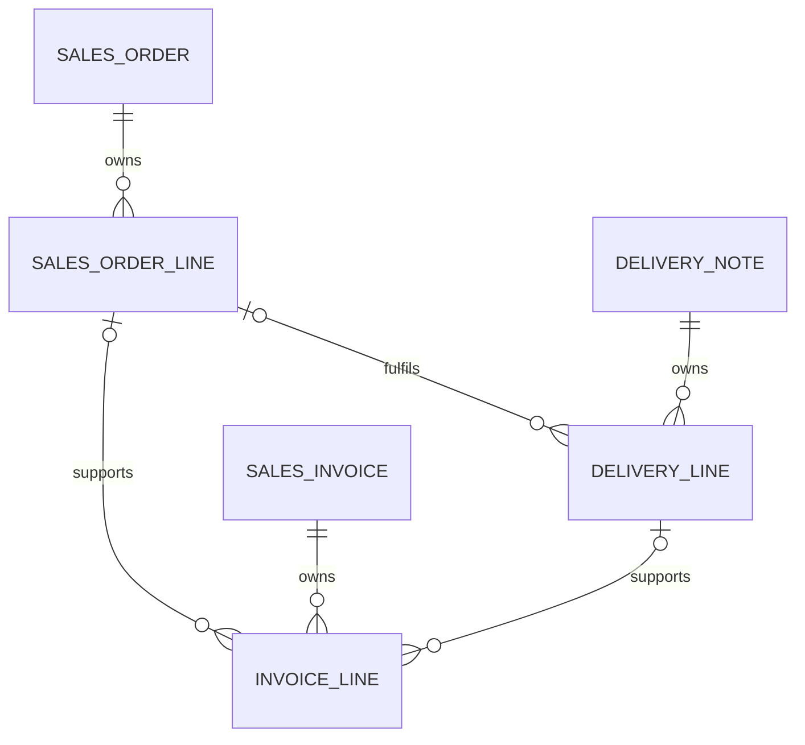

# From an order line to a shipment and an invoice

A sales order owns the lines the customer committed to buy. A delivery note owns the lines that left a warehouse. A sales invoice owns the lines billed. These are three different collections. Each new line receives its own identity and can retain references to the earlier lines that justify it.

In this diagram the optional source end allows a downstream line to exist without a reference of that kind. The transaction policy determines whether a particular document must be linked. One order can be fulfilled by several deliveries, and one delivery line can be invoiced in parts.

| Relationship | Fields to use |
|---|---|
| Order owns order lines | `sales.sales_order.items_rows` contains `sales.sales_order_item` rows. Keep the line identity and its position under the owning order. [Sales dictionary](../../schema/entities/sales.json) |
| Delivery line fulfils an order line | `inventory.delivery_note_item.sales_order_line` identifies a particular order line. Check its parent when resolving the reference. [Delivery dictionary](../../schema/entities/inventory-01.json) |
| Invoice line refers to an order, a delivery or both | `accounting.sales_invoice_item` carries `sales_order_identifier` and `sales_order_line`, as well as `delivery_note_identifier` and `delivery_note_line`. The line reference resolves within the corresponding parent. [Invoice line dictionary](../../schema/entities/accounting-04.json) |
| Invoice owns its billed lines | `accounting.sales_invoice.items_rows` contains the billed lines. Allocating a payment reduces the invoice balance independently of those quantities. [Invoice dictionary](../../schema/entities/accounting-03.json) · [Payment allocations](../../schema/entities/accounting-02.json) |

## Two lines for the same product

Assume no tax or discount, one currency, a separate delivery voucher, equal commercial and stock units, and no other movements. Line A orders ten units at 20.00 from the north warehouse. Line B orders four units of the same product at 25.00 from the south warehouse.

| Order line | Ordered | Delivered | Billed | Still to deliver | Delivered and still to bill | Billed value |
|---|---:|---:|---:|---:|---:|---:|
| A | 10 | 6 | 4 | 4 | 2 | 80.00 |
| B | 4 | 4 | 4 | 0 | 0 | 100.00 |
| Total | 14 | 10 | 8 | 4 | 2 | 180.00 |

The invoice creates a receivable of 180.00. A payment allocated at 100.00 leaves 80.00 outstanding. The payment changes neither the four units awaiting delivery nor the two shipped units awaiting billing. Aggregating by product before resolving the lines would hide which warehouse owes the four units and which price applies to the remaining two shipped units.

For returns and partial credits, preserve the original delivery and invoice line identities independently. Recalculate the physical, billing and settlement balances from their own qualifying documents. [Receipt, shipment, return and cash walkthrough](../transactions/receipt-to-cash.md) · [Billing progress decisions](../calculations/inventory-decisions.md#recognise-delivery-billing-by-amount-and-quantity)
